**CNN-LSTM Model**
- `keras.preprocessing`: `sequence`
- `keras.layers`: `LSTM`, `Embedding`, `Dense`, `add`, `Dropout`, `Input`
- `keras.applications.inception_v3`: `InceptionV3`, `preprocess_input`
- `keras.preprocessing.image`: `load_img`, `img_to_array`

**Transformer Model**
- `torch`: `nn`
- `torch.utils.data`: `DataLoader`
- `torchvision`

### Data pre processing and tokenization transformer model  
- filter out captions that are too long or too short 
- Add special <start> and <end> tokens
### Data pre processing and tokenization baseline model 
- parse loaded text to dictionary 
- remove puncutation, stop word, tokenize , to lowercase

### parse and group captions 
.. image:: media/image17.png
   :alt: Generated caption 4

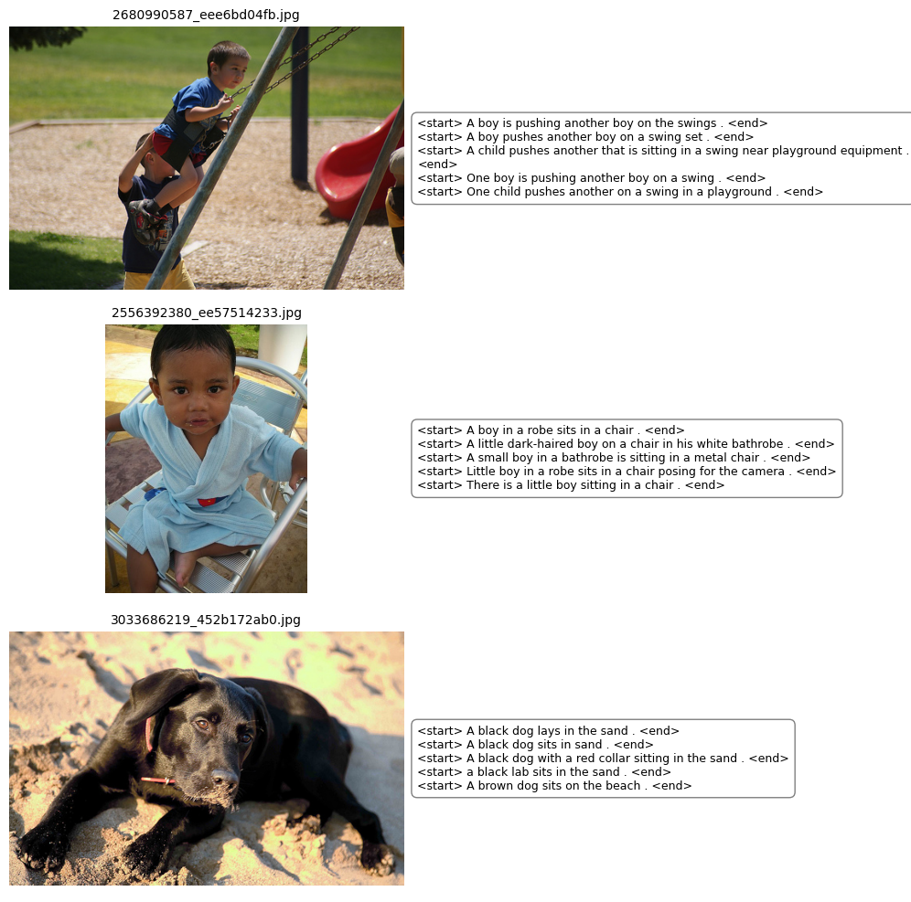
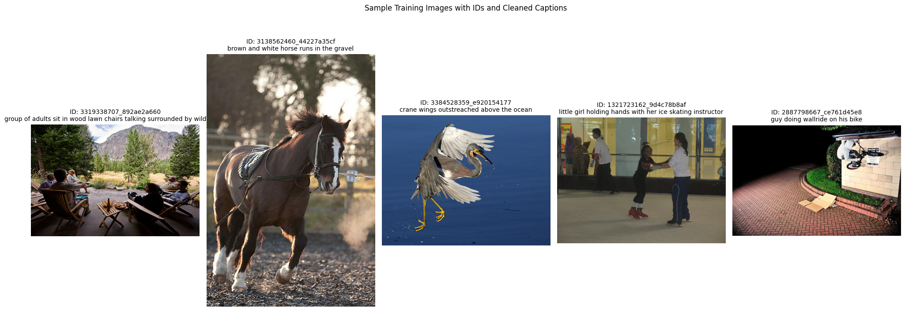

### building vocabulary 
- remove start/end tokens 
- create word to index and index to word mapping 
- Example mappings:
  word2idx['dog'] = 6444
  word2idx['<start>'] = 1
  idx2word[50] = league

### plotting the overall distribution of word frequences in vocabluaray 
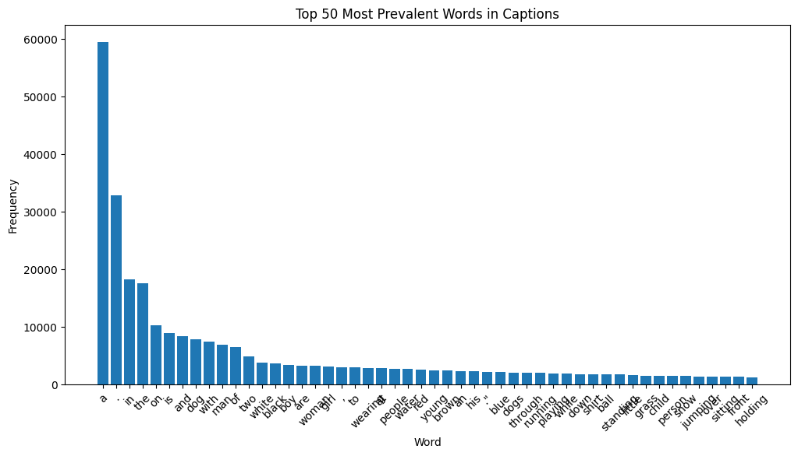

### overall distirbution of word in baseline 
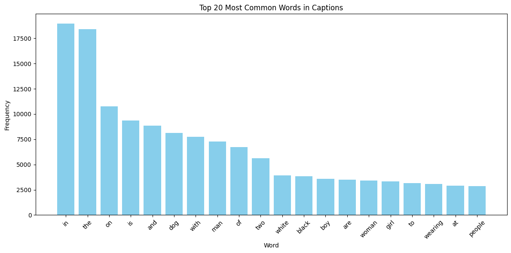

#### creating data splits and dataset adding padding sequence 
- in project 2 Data splitted into:
  - Training samples: 6186
  - Validation samples: 1547

- project 1: 
-----
- token sequence 
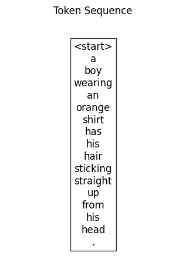

### creating data loaders for batching and initialize the model components 
- train and validation dataloaders 
- initializing models 
    - FeatureExtractor
    - Encoder 
    - Decoder 

## encoder-decoder model in keras involves creating two input streams (one for images, one for text) and merging them to predict the next word
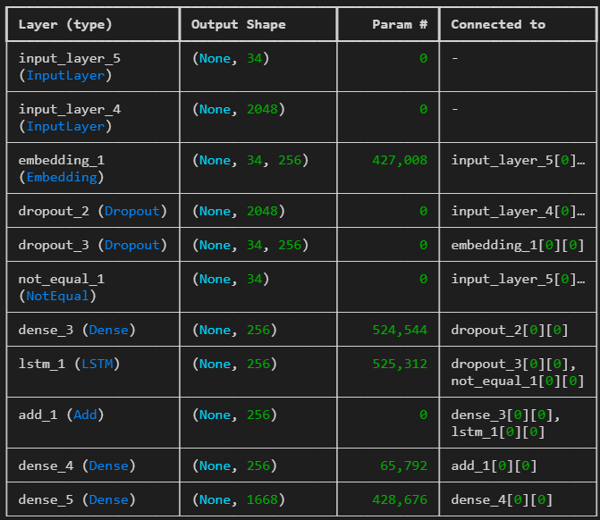

### comment --> make this in a human readable formate 
    Encoder(
  (encoder): TransformerEncoder(
    (layers): ModuleList(
      (0): TransformerEncoderLayer(
        (self_attn): MultiheadAttention(
          (out_proj): NonDynamicallyQuantizableLinear(in_features=512, out_features=512, bias=True)
        )
        (linear1): Linear(in_features=512, out_features=2048, bias=True)
        (dropout): Dropout(p=0.1, inplace=False)
        (linear2): Linear(in_features=2048, out_features=512, bias=True)
        (norm1): LayerNorm((512,), eps=1e-05, elementwise_affine=True)
        (norm2): LayerNorm((512,), eps=1e-05, elementwise_affine=True)
        (dropout1): Dropout(p=0.1, inplace=False)
        (dropout2): Dropout(p=0.1, inplace=False)
      )
    )
  )
  (ff_1): Linear(in_features=1280, out_features=2048, bias=True)
  (ff_2): Linear(in_features=2048, out_features=512, bias=True)
  (layer_norm_1): LayerNorm((1280,), eps=1e-05, elementwise_affine=True)
  (layer_norm_2): LayerNorm((512,), eps=1e-05, elementwise_affine=True)
)

batch of training images 
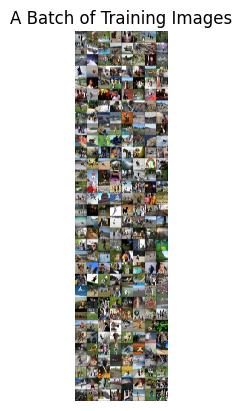

## training loopp 
trains model for one epoch using gradient accumulation to save memory 

### hyperparameters detailes 
batch_size = 256  # batch size per dataloader
    epochs = 20  # num epochs
    learning_rate = 1e-4  # learning rate for optimizer
    d_model = 512   # model's dimension
    n_heads_encoder = 1  # encoders num_heads for multihead attention
    n_heads_decoder = 2  # decoders num_heads for multihead attention

## loss curve 
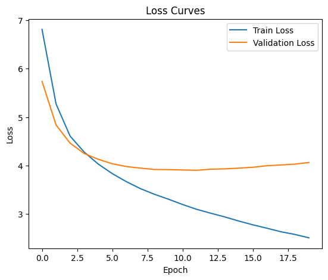

### saving model artifacts 
to encoder_weights.pth 
decoder_weights.pth 
vocab.json 
config.pkl 

## generationg captions for images using greedy search 
transform - resize and normalize images - transform to tensor 

## comparing generated captions with ground truth captions for baeline model
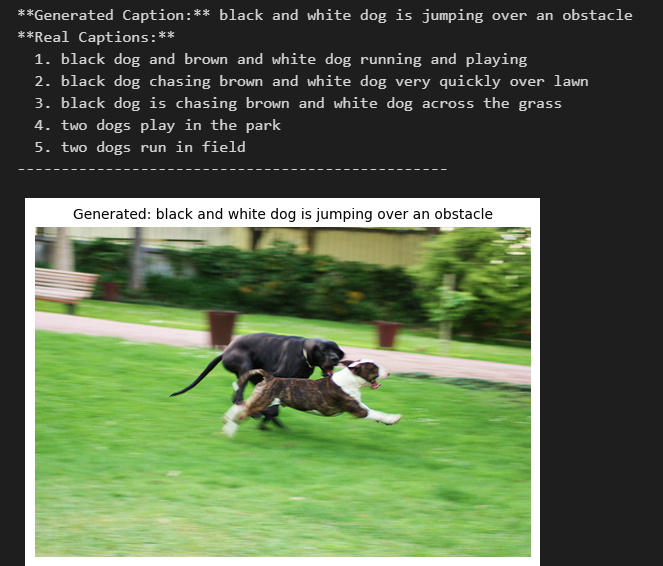
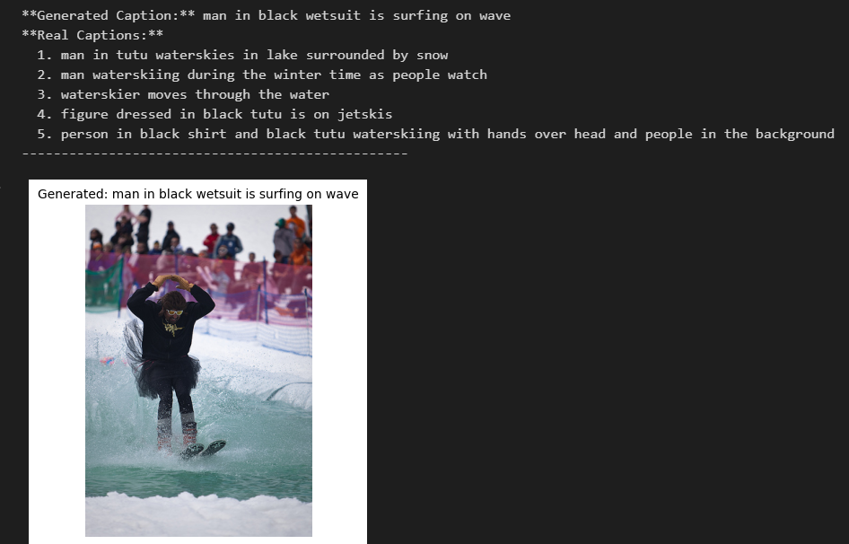
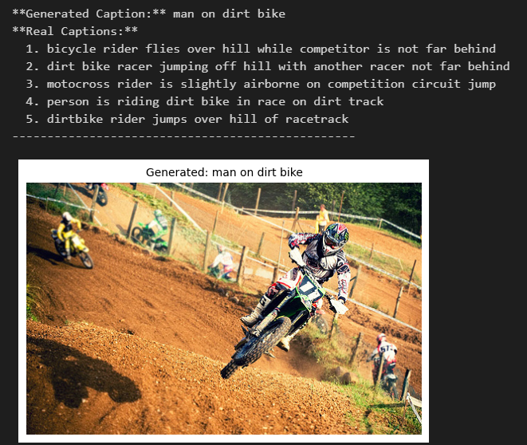
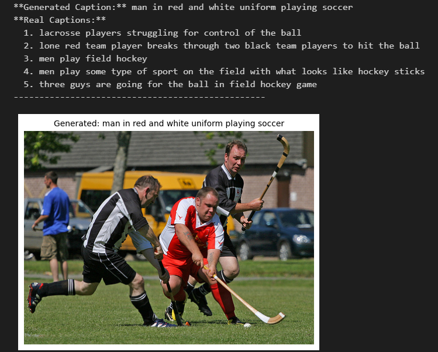

## comparing generated captions with ground truth captions transfomer model 
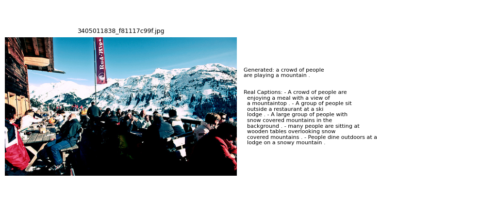
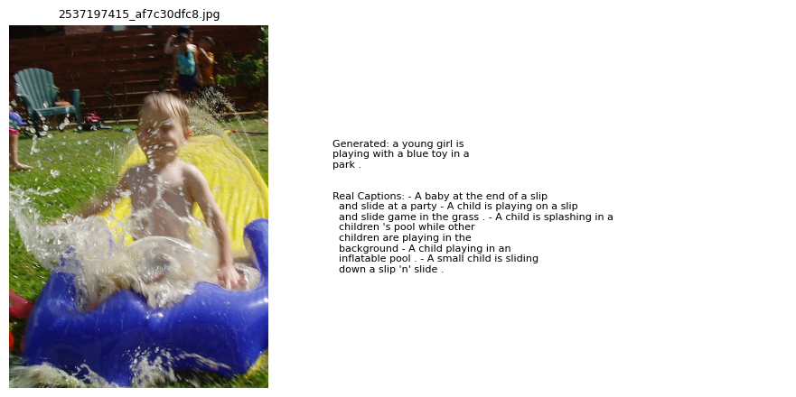
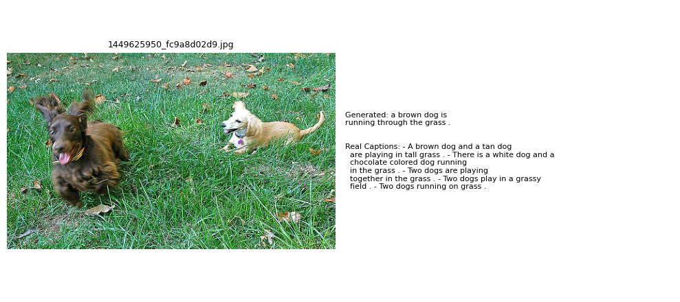
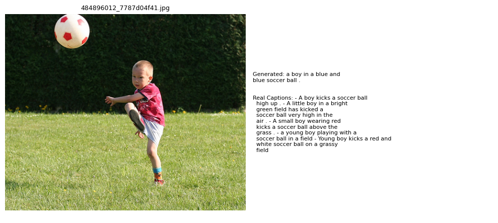
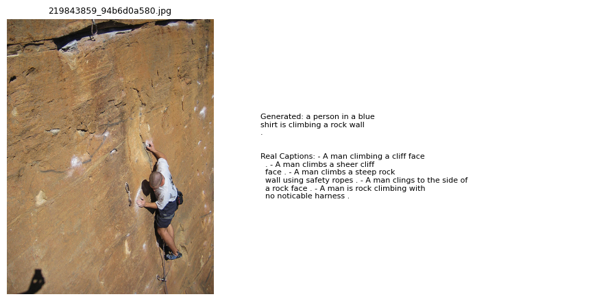

## from nltk bleu corpus and meteor score
What's bleu score 
### BLEU Score

The **BLEU score** evaluates the quality of the generated text by comparing the **n-grams** (contiguous sequences of n words) between the generated caption and one or more reference captions.

#### Formula for BLEU-Score:

\[
\text{BLEU} = \text{BP} \cdot \exp\left( \sum_{n=1}^{N} w_n \log p_n \right)
\]

Where:
- \( N \) is the maximum number of n-grams to consider (typically up to 4).
- \( p_n \) is the precision at the n-gram level, which is calculated as the ratio of the number of n-grams in the candidate translation (generated caption) that match the reference translation to the total number of n-grams in the candidate.
- \( w_n \) is the weight for each n-gram level, typically set to \( \frac{1}{N} \) for equal weighting across all n-grams.

**BP (Brevity Penalty)** is a penalty applied when the generated caption is shorter than the reference. The formula for BP is:

\[
\text{BP} =
\begin{cases} 
1 & \text{if } c > r \\
\exp(1 - \frac{r}{c}) & \text{if } c \leq r
\end{cases}
\]

Where:
- \( c \) is the length of the candidate translation (generated caption).
- \( r \) is the length of the reference translation.

In simpler terms:
- **BLEU** measures **precision** by counting how many n-grams in the generated text match the n-grams in the reference text.
- It penalizes shorter captions using the **Brevity Penalty**.

#### Example:
For **BLEU-4** (using 4-grams), we compare the 4-word sequences between the generated caption and the reference captions.

**BLEU Scores** typically range from **0 to 1**, with **1** indicating a perfect match to the reference captions.

### METEOR Score

The **METEOR score** evaluates the quality of machine-generated captions by considering **unigram matching**, **synonymy**, **stemming**, and **word order**. It tries to improve on BLEU by accounting for more linguistic features such as synonym matching and the flexibility in word order.

#### Formula for METEOR Score:

\[
\text{METEOR} = \frac{10 \cdot \text{precision} \cdot \text{recall}}{\text{precision} + \text{recall}} \cdot \text{penalty}
\]

Where:
- **Precision**: The fraction of words in the generated caption that appear in the reference captions.
- **Recall**: The fraction of words in the reference captions that appear in the generated caption.
- **Penalty**: A penalty term applied based on **word order** and **stemmed synonyms**. The penalty is designed to reduce the score when the word order is different, or synonyms are not used correctly.

#### Components of METEOR:
1. **Precision** and **Recall**:
   - **Precision** is the fraction of the generated caption's words that are also in the reference captions.
   - **Recall** is the fraction of the reference caption's words that appear in the generated caption.

2. **Penalty**:
   - The penalty is applied for differences in word order or when non-synonymous words are used. It ensures that better matches between synonyms and words in the correct order result in higher scores.

In simpler terms:
- **METEOR** is more human-like as it not only checks for exact matches but also accounts for variations in word choice and order (such as synonyms and stemming).
- It penalizes mismatches in word order and synonyms, giving it a more nuanced approach compared to **BLEU**.

#### Example:
If the generated caption is "A dog is running in the park" and the reference caption is "A dog runs in the park," METEOR will consider the synonym "running" and "runs," and also check the word order and recall/precision to calculate the score.

**METEOR Scores** typically range from **0 to 1**, with **1** indicating a perfect match to the reference captions.

- Generate captions for entire validation set and calculate BLEU and METEOR scores
- BLEU and METEOR score for transformer model vs baseline_model image captioning 
            BLEU-1 Score: 0.5464
            BLEU-2 Score: 0.3372
            BLEU-3 Score: 0.2139
            BLEU-4 Score: 0.1318

            METEOR Score: 0.3899
- baseline model image captioning 
                BLEU-1: 0.4334
                BLEU-2: 0.2405
                BLEU-3: 0.1376
                BLEU-4: 0.0743

                Average METEOR Score: 0.2589

pytorch uses cuda to accelerate tensor operations and model training 